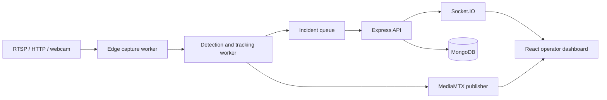

# TransGuard AI

Edge video analytics and an operator dashboard for monitoring camera incidents. The repository contains a Python vision engine, a Node.js API, a React dashboard, and Docker deployment files.

> **Project status:** Active development. Detection thresholds and event logic are configurable, but this repository does not include a published, labeled field evaluation. Measure false alerts and missed detections on representative footage before relying on the system operationally.

## What’s included

- **Edge engine:** RTSP, HTTP, and webcam capture; YOLO object detection and tracking; event detectors for crowding, unattended baggage, falls, weapons, violence, and watchlist matches.
- **API and storage:** Express endpoints, MongoDB models, authentication, edge event ingestion, and Socket.IO updates.
- **Operator dashboard:** React views for cameras, incidents, live video, maps, and operational summaries.
- **Streaming:** MediaMTX configuration for RTSP, WebRTC, and HLS workflows.

The detectors use model outputs, tracking, geometry, and temporal rules. Their scores are not a substitute for per-camera validation or calibrated probabilities.

## Architecture



The Python engine runs capture, inference, publishing, and telemetry in separate worker processes. Queues are bounded so slow consumers do not cause unbounded frame backlog.

## Requirements

- Node.js 20 or newer and npm
- Python 3.10 or 3.11 for the edge engine
- MongoDB for persistent backend storage
- Camera stream or webcam for live edge inference
- Model weights required by the selected detectors

The Python dependencies include PyTorch, Ultralytics, MediaPipe, and face-recognition/dlib. Install them in a virtual environment and use the platform-specific installation guidance for dlib where needed.

## Local setup

### Backend

```bash
npm install
cp .env.example .env
# Edit .env and set unique secrets and your MongoDB connection.
npm start
```

The API listens on port `5000` by default. Do not use example secrets for a deployed instance.

### Dashboard

In another terminal:

```bash
cd frontend
npm install
npm run dev
```

Vite prints the local dashboard URL. The production bundle can be generated with `npm run build` from `frontend/`.

### Edge engine

Create a Python virtual environment, install dependencies, and configure the edge environment:

```bash
python -m venv .venv
# Activate the environment using the command for your shell.
pip install -r requirements.txt
cp .env.edge.example .env.edge
# Set the camera URL and an EDGE_API_KEY matching the backend's configured key.
python trans_guard_engine.py
```

The engine loads `.env.edge` from the current working directory. Set `EDGE_ENV_FILE` to use a different file. Existing process environment variables take precedence over values in the file. CLI options override environment defaults; use `python trans_guard_engine.py --help` to see them.

To select a source directly:

```bash
python trans_guard_engine.py --camera CAM_01 --rtsp "rtsp://camera-address/stream" --backend-url "http://127.0.0.1:5000"
```

Numeric camera sources such as `--rtsp 0` select a local webcam. RTSP credentials should be supplied through protected configuration and should not be committed to the repository.

## Configuration

### Backend (`.env`)

| Variable | Purpose |
| --- | --- |
| `MONGO_URI` | MongoDB connection string |
| `JWT_SECRET` | Secret used to sign dashboard sessions |
| `DEFAULT_ADMIN_PASSWORD` | Initial development admin account password |
| `DEFAULT_EDGE_API_KEY` | Initial edge node key; configure the same key on the engine |
| `PORT` | API port, default `5000` |
| `NODE_ENV` | Runtime mode |
| `CORS_ORIGINS` | Comma-separated allowed origins |

### Edge (`.env.edge`)

| Variable | Purpose | Example default |
| --- | --- | --- |
| `RTSP_URL` | Camera URL or numeric webcam index | `rtsp://127.0.0.1:8554/cam0` |
| `BACKEND_URL` | API base URL | `http://127.0.0.1:5000` |
| `EDGE_API_KEY` | Must match the backend edge key | Set locally |
| `CAMERA_ID` | Unique camera identifier | `cam0` |
| `YOLO_MODEL` | Primary object model path | `yolov8n.pt` |
| `YOLO_CONF` | Primary model confidence floor | `0.45` |
| `WEAPON_MODEL` | Weapon model path | `yolov8n-weapons.pt` |
| `WEAPON_CONF` | Weapon model confidence floor | `0.38` |
| `WEAPON_CONFIRM_FRAMES` | Temporal confirmation setting for lower-confidence hits | `4` |
| `CROWD_THRESHOLD` | Crowd headcount threshold | `8` |
| `CROWD_FRAMES` | Crowd confirmation frames | `20` |
| `FACE_MATCH_TOLERANCE` | Face matching distance threshold | `0.50` |
| `FRAME_WIDTH`, `FRAME_HEIGHT`, `FRAME_FPS` | Capture dimensions and target rate | `1280`, `720`, `25` |
| `VEHICLE_ID` | Vehicle label attached to incidents | `BUS_001` |
| `FALLBACK_LAT`, `FALLBACK_LON` | Base coordinates for the engine's approximate location payload; this is not a live GPS feed | Configured locally |

Thresholds depend on camera placement, image quality, model weights, and frame rate. Tune them against labeled footage; avoid raising or lowering a threshold based only on a few incidents.

## Docker

Copy both environment templates before starting Compose. The edge file is referenced by the engine service even when its profile is not selected.

```bash
cp .env.example .env
cp .env.edge.example .env.edge
# Set unique secrets and configure the camera and edge key.
docker compose up -d
```

The edge engine is behind the `full` profile:

```bash
# Configure camera, backend address, and matching edge key in .env.edge.
docker compose --profile full up -d
```

Review `docker-compose.yml` before deployment to confirm the selected profile, camera networking, model mounts, and environment values suit the target host.

## Useful commands

```bash
npm test                  # Python detector tests followed by backend tests
npm run test:backend      # Backend API tests
npm run lint              # Root JavaScript lint
```

For frontend checks:

```bash
cd frontend
npm test
npm run lint
npm run build
```

The combined root test command requires Python to be available as `python`. Run individual checks only after installing their project dependencies.

## API overview

| Method | Endpoint | Purpose |
| --- | --- | --- |
| `POST` | `/api/auth/login` | Authenticate a dashboard user |
| `POST` | `/api/alerts` | Receive an edge incident |
| `GET` | `/api/alerts/history` | Retrieve incident history |
| `POST` | `/api/edge/heartbeat` | Receive edge node health |
| `GET` | `/api/edge/cameras` | List camera nodes |
| `GET`, `POST` | `/api/watchlist` | Read or update watchlist entries |
| `GET` | `/api/health` | Check API and database health |

See `routes/` for route behavior and authentication requirements.

## Further documentation

- [Mobile camera demo guide](docs/MOBILE_DEMO_GUIDE.md)
- [Architecture and project state](docs/PROJECT_ARCHITECTURE_AND_STATE.md)
- [System diagrams](docs/DIAGRAMS.md)
- [Computer vision architecture](docs/TECHNICAL_ARCHITECTURE.md)

## Security and privacy

Use unique, randomly generated secrets for the API, JWT signing, and administrator account. Keep `.env`, `.env.edge`, camera credentials, watchlist images, and incident evidence out of source control. Restrict network access to camera streams and backend endpoints, and apply the retention policy required by your deployment. Watchlist matching involves sensitive biometric data; define authorization, access, retention, and review procedures before enabling it.

## License

ISC. See `package.json` for package metadata.
